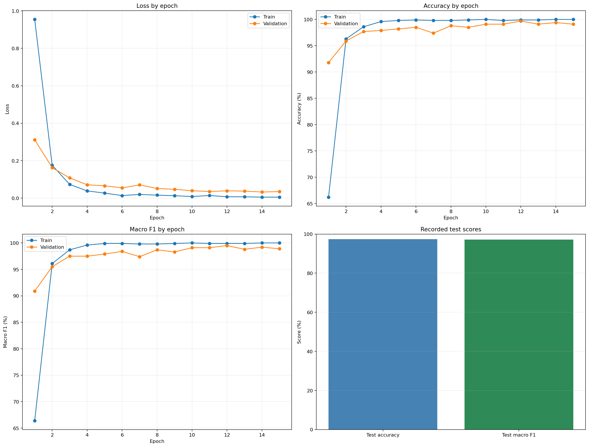

# Plant classifier: CNN stage

This project starts with a pretrained ResNet-18 CNN in PyTorch. It reads one folder per plant class, makes a reproducible, stratified 60/20/20 train/validation/test split, uses training-only augmentation and class-weighted loss, and saves the best validation checkpoint plus test metrics. The split is calculated separately within each class so each class is represented in all three sets. Counts can differ slightly from the exact percentages because images are indivisible; `split_summary.json` records the actual counts for each run.

The current source folders contain 1,706 JPEG photos:

| Class folder | Images |
|---|---:|
| `bougainvillea` | 192 |
| `copperleaf_plant` | 71 |
| `golden_net_bush` | 112 |
| `ixora_coccinea` | 308 |
| `lantana_camara` | 228 |
| `purple_false_erantheum` | 162 |
| `Tabernaemontana litoralis` | 319 |
| `tecomaria_capensis` | 93 |
| `Variegated Tecoma` | 132 |
| `wild jasmine` | 89 |

## Dataset layout

Keep the dataset outside GitHub. The directory passed to `--data-dir` should contain the 10 plant folders directly:

```text
images/
  bougainvillea/
  copperleaf_plant/
  golden_net_bush/
  ixora_coccinea/
  lantana_camara/
  purple_false_erantheum/
  Tabernaemontana litoralis/
  tecomaria_capensis/
  Variegated Tecoma/
  wild jasmine/
```

Folder names become the model's class labels. Spaces and capitalization are supported.

## Local run

Install a PyTorch build appropriate for your system from the [official PyTorch install selector](https://pytorch.org/get-started/locally/), then install the supporting libraries:

```bash
python -m pip install scikit-learn matplotlib pandas
python train_cnn.py --data-dir "C:/Playground/plant_classifier/images" --output-dir outputs/cnn
```

The script automatically selects CUDA when PyTorch detects an available NVIDIA GPU, and enables automatic mixed precision on CUDA. Otherwise, it uses the CPU.

## Open and use the project in PyCharm

For a Git-connected PyCharm project, choose **Get from VCS** (or **File → New Project from Version Control**), paste `https://github.com/ADITYA1488/plant_classifier.git`, and clone it to a folder such as `C:/Playground/plant_classifier_github`. The image dataset is intentionally not stored on GitHub. Keep using the existing local images at `C:/Playground/plant_classifier/images` or copy them into the cloned project's ignored `images` folder.

In PyCharm, set the project interpreter to a virtual environment. Install a CUDA-enabled PyTorch/TorchVision build using the [official PyTorch selector](https://pytorch.org/get-started/locally/), then install the other libraries in the PyCharm terminal:

```bash
python -m pip install scikit-learn matplotlib pandas
```

To **view the recorded Kaggle run without training again**, open the PyCharm terminal at the repository root and run:

```bash
python view_results.py
```

It reads the committed run summary and epoch history, prints the recorded scores, displays charts, and saves `results/results_dashboard.png`. The plotted charts include loss, accuracy, and macro F1 by epoch. If you have a complete training output folder with the test report and confusion matrix, point the viewer to that folder:

```bash
python view_results.py --results-dir outputs/cnn_60_20_20
```

To train a new local run on an RTX 3050 with 4 GB of VRAM, use a smaller batch size:

```bash
python train_cnn.py --data-dir "C:/Playground/plant_classifier/images" --output-dir outputs/cnn_60_20_20 --epochs 15 --batch-size 8
```

## Kaggle or Colab

Upload the code to GitHub and the image dataset separately. In the hosted notebook, install the requirements (or use the platform's installed PyTorch), make the dataset visible to the runtime, then call `train_cnn.py` with that runtime's dataset path. Save the `outputs/cnn` directory to persistent storage before the session ends.

The training script uses ImageNet-pretrained ResNet-18 weights by default. The runtime needs internet access the first time it downloads those weights. To initialize randomly instead, pass `--no-pretrained`.

For the guided Google Colab flow, open `cnn_colab.ipynb`. It mounts Drive, checks the GPU, checks for all 10 class folders, copies the dataset to the runtime disk, runs the training script, and saves results back to Drive. Set the repository URL in the notebook after the GitHub repository exists.

## Outputs

- `best_resnet18.pt`: checkpoint selected by validation macro F1
- `test_report.json`: overall and per-class test metrics
- `test_confusion_matrix.csv`: test confusion matrix
- `training_history.json`: per-epoch metrics
- `split_summary.json`: exact total and per-class train/validation/test counts, plus the random seed
- `results_dashboard.png`: plots created by `view_results.py`

The test split is evaluated once at the end. Use validation metrics when adjusting training settings. Results from the 60/20/20 split are not directly comparable to the earlier 70/15/15 run because the images in the validation and test sets have changed. The latest completed 60/20/20 run is recorded below.

## Latest completed CNN run

The latest [Kaggle run](https://www.kaggle.com/code/adityashrinet/notebook0f7248d0eb/edit/run/363345110) used the 60/20/20 split and completed all 15 epochs on a Tesla T4 with automatic mixed precision. It used 1,024 training images, 341 validation images, and 341 test images. The best validation macro F1 was 0.995 at epoch 12. Final test accuracy was **0.974 (97.4%)** and test macro F1 was **0.972 (97.2%)**.

The recorded run summary and per-epoch training/validation metrics are in [`results/cnn_60_20_20_summary.json`](results/cnn_60_20_20_summary.json) and [`results/cnn_60_20_20_training_history.json`](results/cnn_60_20_20_training_history.json). These files record the aggregate metrics visible in the Kaggle run; the complete per-class test report and trained checkpoint remain in the Kaggle output ZIP.

### Training and evaluation charts

The chart below is generated from the committed Kaggle training history and summary. It shows loss, accuracy, and macro F1 over epochs, plus the recorded test scores.


